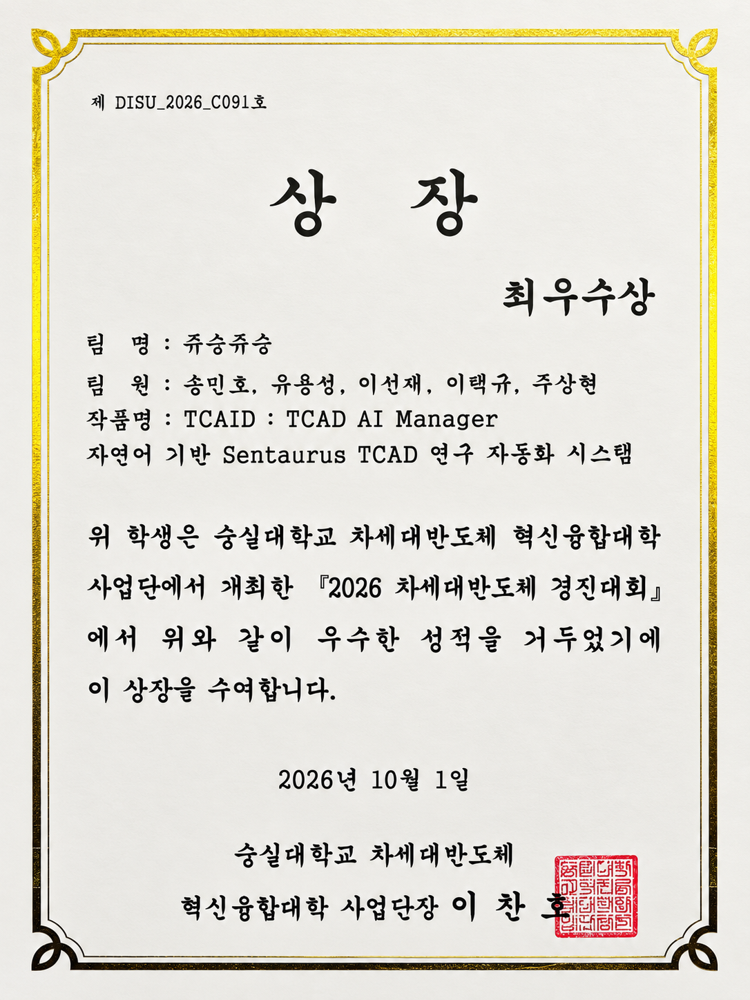
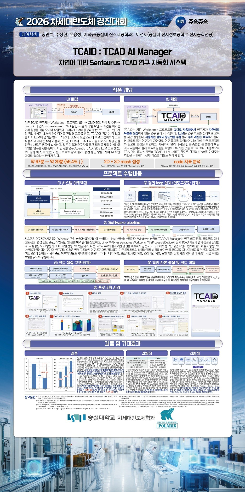

[← 포트폴리오 홈으로](../../)

# 2026 차세대반도체 경진대회

**최우수상 (대회 최고상)**

**수상 작품:** TCAID: TCAD AI Manager — 자연어 기반 Sentaurus TCAD 연구 자동화 시스템

| 항목 | 내용 |
| --- | --- |
| 수상 등급 | **최우수상 (대회 최고상)** |
| 수상일 | 2026년 10월 1일 |
| 주최 | 숭실대학교 차세대반도체 혁신융합대학 사업단 |
| 팀명 | 쥬송쥬송 |
| 팀원 | 송민호, 유용성, 이선재, 이택규, 주상현 |
| 작품명 | TCAID: TCAD AI Manager |

본 대회는 대상을 시상하지 않았으며, **최우수상이 최고 수상 등급**에 해당합니다.

---

## 01. 수상 상장

  

상장 원본 사진의 기울기와 배경을 보정한 이미지입니다. 클릭하면 크게 볼 수 있습니다.

## 02. 발표 포스터

  

대회 발표에 사용한 포스터입니다. 클릭하면 전체 크기로 볼 수 있습니다.

---

**[→ TCAID: TCAD AI Manager 프로젝트 상세 페이지](../../tcaid/)** — 시스템 아키텍처, 승인 기반 실행, 실제 SProcess·SDevice 시연, 시간 단축 검증, 시연 영상 및 전시 포스터

[← 포트폴리오 홈으로](../../)
